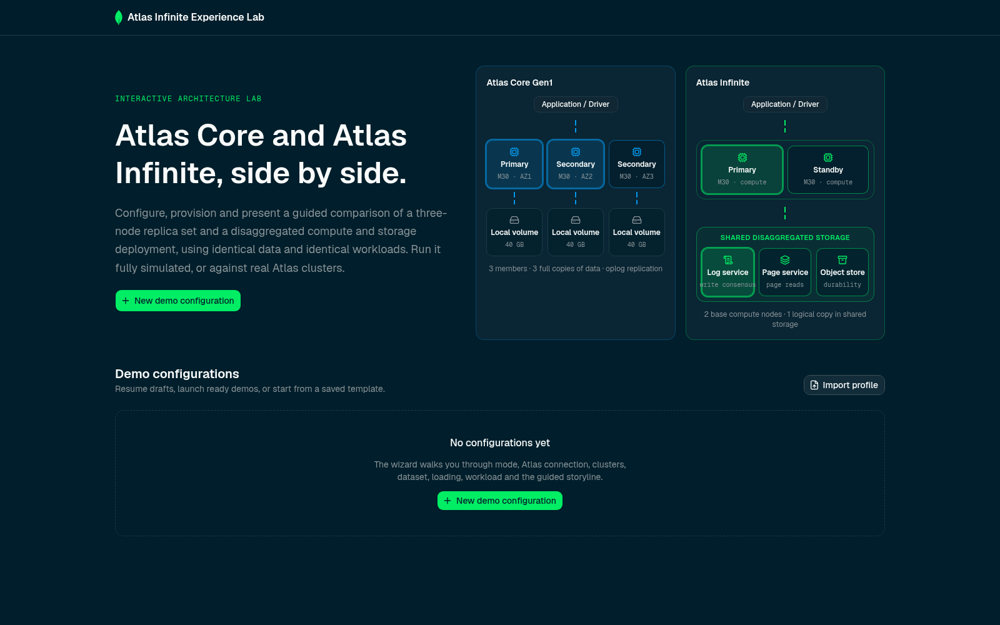
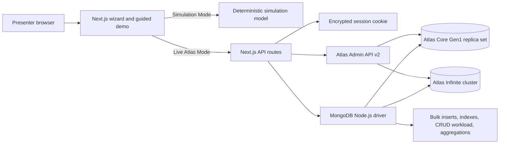
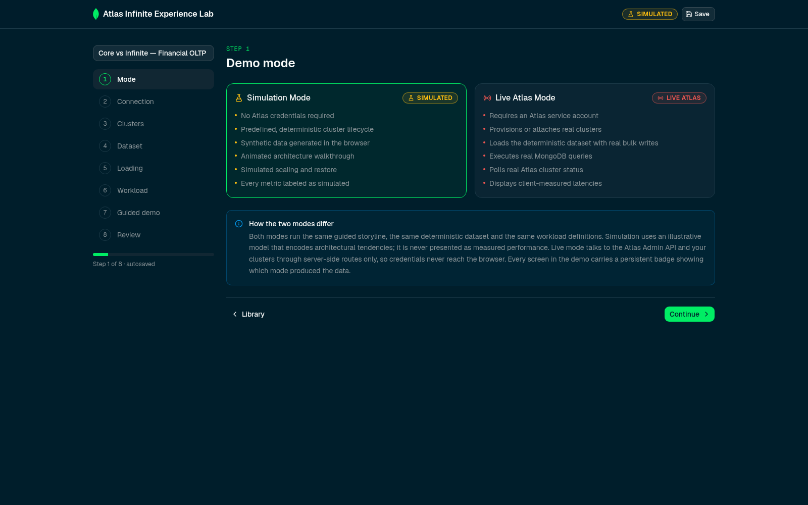
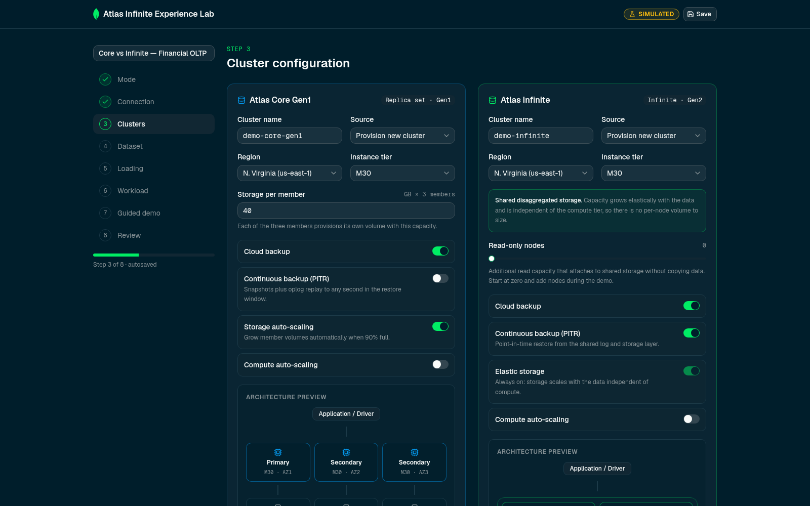
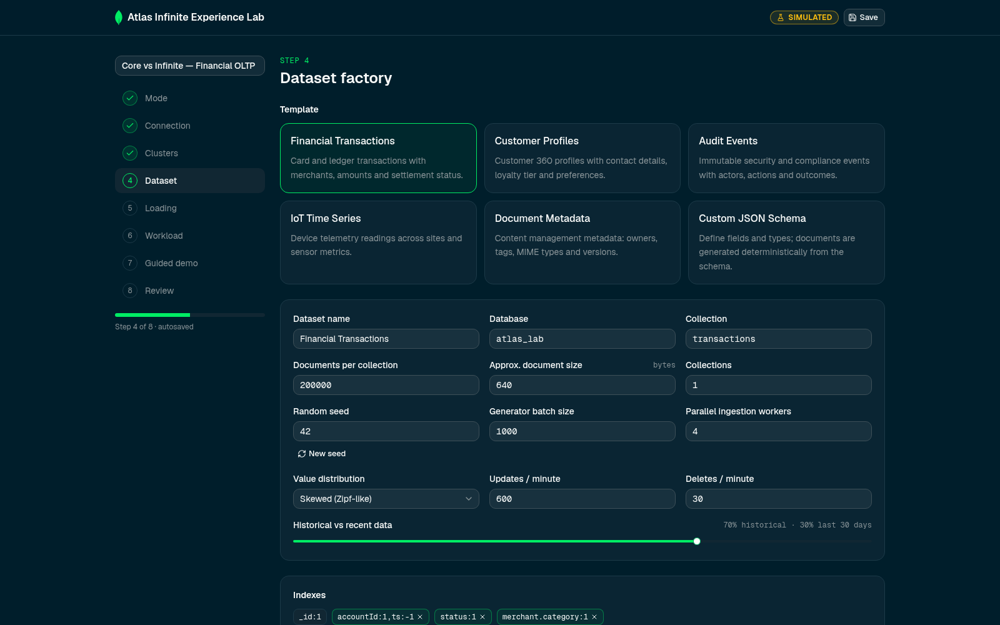
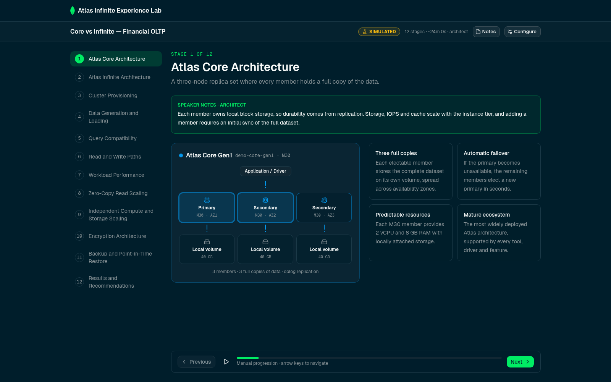
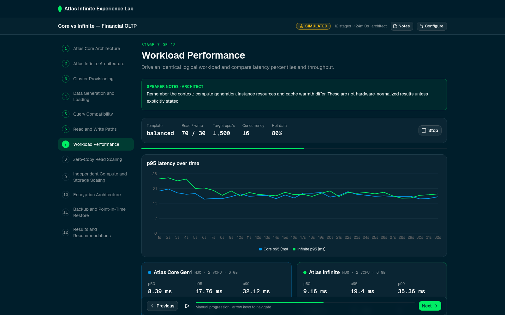

# Atlas Infinite Experience Lab

An interactive, guided demo that compares **MongoDB Atlas Core Gen1** (a three-node replica set) with **MongoDB Atlas Infinite** (two base compute nodes, Primary and Standby, on shared disaggregated storage). An eight-step wizard configures the clusters, a deterministic synthetic dataset, ingestion, a workload and a twelve-stage storyline. It runs fully in **Simulation Mode** (no credentials) or in **Live Atlas Mode** against real clusters through server-side API routes. Built with Next.js 16, TypeScript, the MongoDB Node.js driver and the LeafyGreen palette.



## Business problem

Architects and decision makers need to understand how a disaggregated compute/storage deployment differs from a traditional replica set (number of data copies, read scaling, storage growth, backup and restore) before choosing one. Slides make this abstract, and building a fair, repeatable comparison by hand takes time.

## Solution

The lab generates the **same seeded dataset** (identical `_id` values and contents) and runs the **same logical workload** against both deployments. It visualizes each architecture and walks a presenter through provisioning, loading, query compatibility, read/write paths, workload latency, zero-copy read scaling, independent compute and storage scaling, encryption, backup/PITR and recommendations, with speaker notes for Executive, Developer or Architect audiences.

- **Simulation Mode:** an illustrative, deterministic model (`lib/simulation.ts`). Every metric is labeled as simulated.
- **Live Atlas Mode:** server routes call the Atlas Admin API v2 and the MongoDB Node.js driver. Latencies are client-measured and not hardware-normalized.

## Architecture



1. Demo configurations are stored in the browser's localStorage (`lib/store.ts`) and edited in the wizard.
2. In Live Atlas Mode, credentials are posted to `/api/atlas/credentials` and kept only in an AES-256-GCM encrypted HttpOnly cookie (`lib/server/session.ts`).
3. `/api/atlas/check` and `/api/atlas/clusters` call the Atlas Admin API v2 (`lib/server/atlas.ts`) to validate the project and provision or read clusters. Only the Core Gen1 replica set is provisioned by the lab; Atlas Infinite is attached as an existing cluster.
4. `/api/live/data` generates seeded documents in batches, bulk-inserts them into both clusters, then verifies counts, indexes and fingerprints.
5. `/api/live/workload` runs the identical read/write/aggregate mix against both clusters and returns p50/p95/p99 latency.

## MongoDB capabilities

| Capability | Why used | File |
| --- | --- | --- |
| Atlas | Atlas Admin API v2: connection test, access list, database users, limits, cluster provisioning and status | `lib/server/atlas.ts` |
| CRUD | `insertMany` for ingestion; `find`, `insertOne`, `updateOne`, `deleteOne` in the workload | `app/api/live/workload/route.ts` |
| Aggregation | `$collStats` for verification, `$group`/`$sort`/`$limit` for fingerprints and analytics queries | `app/api/live/data/route.ts` |
| Atlas Infinite | The storyline contrasts Primary/Standby compute on shared storage with a three-node replica set | `components/lab/architecture.tsx` |

## Prerequisites

| Tool | Version | Check |
| --- | --- | --- |
| Node.js | 20 or newer | `node --version` |
| pnpm | 9 or newer | `pnpm --version` |
| Git | any | `git --version` |

On macOS, install them with Xcode Command Line Tools (`xcode-select --install`), [Homebrew](https://brew.sh) (`brew install node`) and Corepack (`corepack enable`).

## Run locally

### Clone the repository

Download the code and enter the project folder.

```bash
git clone https://github.com/bobbertonno/atlas-infinite.git
cd atlas-infinite
```

### Launch with one command (macOS)

The launcher checks Node.js and pnpm, creates `.env.local` with a generated `ATLAS_LAB_SECRET`, installs dependencies, builds, starts the server and opens http://localhost:3000. Use `--dev` for hot reload or `PORT=4000` for another port. Press `Ctrl+C` to stop.

```bash
./scripts/launch-mac.sh
```

### Create the environment file manually

Generate the secret that encrypts credentials in the session cookie. `.env.local` is git-ignored. See `.env.example`.

```bash
echo "ATLAS_LAB_SECRET=$(openssl rand -base64 32)" > .env.local
chmod 600 .env.local
```

### Install, build and start manually

Install dependencies, build the production bundle and start it on port 3000.

```bash
pnpm install
pnpm build
pnpm start
```

### Run the development server

Use hot reload while editing code.

```bash
pnpm dev
```

### Deploy to Vercel (optional)

Builds locally, installs the Vercel CLI if needed, links the project, copies `ATLAS_LAB_SECRET` to the production environment and runs `vercel deploy --prod`. For Live mode on Vercel, the cluster must accept Vercel's egress IPs (broader access list, Vercel Static IPs, or Secure Compute with private networking).

```bash
./scripts/launch-mac.sh --vercel
```

## Atlas setup

Only needed for Live Atlas Mode. Live mode creates real clusters that cost money; delete them when you finish.

### Create an Atlas service account

In Atlas, open **Project Settings, Access Manager, Applications, Service Accounts** and create credentials with the **Project Owner** role (needed to create and scale clusters). Copy the Client ID, Client Secret and Project ID. They are entered in the wizard, not in env files.

```bash
echo "Client ID, Client Secret and Project ID are entered in the wizard, not in env files"
```

### Allow your IP in Atlas Network Access

Find your public IP and add it to the project IP Access List, and to the Admin API access list if your organization requires one.

```bash
curl -s https://checkip.amazonaws.com
```

### Prepare an Atlas Infinite cluster

The lab provisions only the Core Gen1 replica set. Create an Atlas Infinite cluster in the same project where your organization supports it, then set the Atlas Infinite source to an existing cluster in wizard step 3.

```bash
echo "Set the Atlas Infinite source to an existing cluster in wizard step 3"
```

### Connect from the Atlas wizard step

Choose **Live Atlas Mode**, enter the credentials in the **Atlas Connection** step and run **Test Atlas API Connection**.

```bash
open http://localhost:3000
```

## Configuration

| Variable | Required | Secret | Modes | Description |
| --- | --- | --- | --- | --- |
| `ATLAS_LAB_SECRET` | No | Yes | atlas-connected | Key material for AES-256-GCM encryption of the credential session cookie. If unset, an ephemeral key is used and credentials must be re-entered after each server restart. |

Atlas credentials and the database user are entered in the wizard and never stored in env files.

## Demo walkthrough



1. Open http://localhost:3000 and click **New demo configuration**.
2. **Mode:** pick Simulation Mode (no credentials) or Live Atlas Mode. A persistent badge shows which mode produced the data.
3. **Connection** (Live only): enter credentials and run the connection, permission, region and quota checks.
4. **Clusters:** review `demo-core-gen1` (three nodes, own volumes) and `demo-infinite` (Primary and Standby on shared storage, optional read-only nodes).

   

5. **Dataset:** choose a template (Financial Transactions, Customer Profiles, Audit Events, IoT Time Series, Document Metadata or Custom JSON Schema), the seed, document count and indexes, and preview sample documents.

   

6. **Loading, Workload, Guided demo:** set ingestion options, the workload template and which of the twelve stages to show.
7. **Review:** click **Launch demo**.
8. Walk through the stages with **Next** or the arrow keys; toggle **Notes** for speaker notes.

   

9. On **Workload Performance**, click **Run identical workload** to compare p50, p95 and p99 latency and throughput.

   

10. Finish with **Results and Recommendations**. Configurations can be exported and imported from the home page library.

## Troubleshooting

| Problem | Fix |
| --- | --- |
| `permission denied: ./scripts/launch-mac.sh` | `chmod +x scripts/launch-mac.sh` |
| `Port 3000 is already in use` | `PORT=4000 ./scripts/launch-mac.sh`, or find the process with `lsof -i :3000` |
| `Node.js ... is too old` | `brew upgrade node` |
| pnpm version error from Corepack | `npm install -g pnpm` and run the script again |
| Credentials requested again after a restart | Make sure `.env.local` contains `ATLAS_LAB_SECRET` |
| Atlas connection times out | Add your current public IP to Atlas Network Access |
| Build fails after `git pull` | `rm -rf node_modules .next && pnpm install && pnpm build` |

## Limitations

- The lab provisions only Atlas Core Gen1 replica sets. Atlas Infinite clusters must already exist and are attached by name.
- Simulation Mode metrics come from an illustrative model and are not measurements.
- Live latencies are measured from the app server and are not hardware-normalized; compute generation, instance resources, cache state and network location differ between clusters.
- Demo configurations live in browser localStorage, so they are per browser and per device.
- On Vercel, serverless function time limits bound how long a single ingestion or workload request can run.

## Security notes

- Atlas credentials are sent only to the app's own server routes, encrypted with AES-256-GCM into an HttpOnly cookie (8-hour lifetime), and never returned to client JavaScript, logs or exported profiles.
- Set `ATLAS_LAB_SECRET` to a random value and keep `.env.local` out of version control (it is git-ignored).
- Use a dedicated Atlas project and a service account scoped to that project, and delete demo clusters and credentials after the session.
- Restrict Atlas Network Access to the IPs that actually run the app.
